  

# 📊 Awesome Accounting & ERP Integrations

**A curated directory of top-tier SaaS platforms, APIs, middleware connectors, and open-source GitHub projects for automated accounting, general ledger synchronization, and enterprise ERP integration.**

  
  
  
  
  
  

  <em>Focused on GL Sync, Automated Invoicing, AP/AR Workflows, Multi-Entity Consolidation &amp; Self-Hosted Financial Systems</em>

  🌟 <strong>Star this repository if you find it helpful!</strong> 🌟

---

## 📑 Table of Contents

- [📈 Sector Overview & Market Dynamics](#-sector-overview--market-dynamics)
- [☁️ SaaS / Hosted Platforms](#️-saas--hosted-platforms)
- [💻 Open-Source GitHub Projects](#-open-source-github-projects)
- [🤝 How to Contribute](#-how-to-contribute)
- [💖 Support & Sponsorship](#-support--sponsorship)
- [⭐ Star History](#-star-history)
- [⚠️ Disclaimer](#️-disclaimer)

---

## 📈 Sector Overview & Market Dynamics

The global core ERP market is valued at approximately **$64B to $85B+**, with the dedicated ERP system integration, middleware (iPaaS), and consulting ecosystem driving an additional **$15B+** in annual spending fueled by cloud migration and AI automation. 

- **Concentrated Core ERP Market:** The underlying financial database tier is **heavily concentrated** (oligopolistic) among entrenched titans (SAP, Oracle/NetSuite, Intuit, Workday, and Sage) due to monumental enterprise switching costs.
- **Fragmented Integration & Middleware Layer:** In contrast, the middleware, workflow automation, and custom API connector layer is **moderately fragmented**, leaving significant opportunity for specialized SaaS connectors (Celigo, Chargebee, Tipalti) and robust self-hosted open-source software (Odoo, ERPNext, Firefly III).

---

## ☁️ SaaS / Hosted Platforms

| 🏢 Platform / Product | 💼 Company Size (Valuation / Revenue) | 🏷️ Pricing (Starting Tier) | 🎁 Free Tier Limits | 🔍 Key Highlights & Trade-offs |
| :--- | :--- | :--- | :--- | :--- |
| **[SAP S/4HANA Connector](https://www.sap.com/)** | ~$255B–$270B Market Cap (~€33B+ Annual Rev) | $180/user/month (Base Edition, min 15 users ~$2,700/mo) | 30-day free trial (shared tenant, pre-loaded demo data; 14-day trial for Public Sector) | Enterprise ERP integration via OData/CDS views or middleware (APOS/Theobald). Requires significant BASIS/infrastructure setup. |
| **[QuickBooks Online Sync](https://quickbooks.intuit.com/)** *(SimpleCommerceSync)* | ~$92B–$95B Intuit Market Cap (~$16B+ Rev) / Image in a Box: Boutique Dev | $30/month (Pro plan; SimpleCommerceSync for HubSpot-to-QBO) | Free forever plan: limited to 5 invoices, 5 quotes, 5 payments, and 5 products/month (1 user) | SMB connector linking external commerce & CRMs to QBO. Depth and quality vary by connector. |
| **[Workday Financials Integration](https://www.workday.com/)** | ~$47B–$50B Market Cap (~$8.4B+ Annual Rev) | ~$25,000/month (~$300,000/year for Core 3,000 FTE band) | 30-day free trial limited to Workday Adaptive Planning; Core Financials offers guided live demo only | Top-tier enterprise financials and HCM sync. High total cost of ownership; integration toolkits separately licensed. |
| **[Sage Intacct Integration](https://www.sage.com/intacct)** | ~$11B–$11.7B Sage Group Market Cap (~£2.3B+ Rev) | $208.33/month ($2,500/year annual partner fee + $0.015/API call after credit) | 30-day free trial (access to sandbox environment with sample multi-entity demo data; $1,000/mo API credit on partner program) | Cloud financial management with rich multi-entity consolidation. Developers need partnership/SenderID licenses. |
| **[Tipalti AP Sync](https://tipalti.com/)** | $8.3B Valuation (~$200M+ ARR) | $99/month (Standard AP platform subscription + transaction fees per payment/invoice) | 14-day guided sandbox access upon sales qualification (no self-serve free tier; live demo available) | Comprehensive AP automation with 2-way GL synchronization for Sage Intacct & NetSuite. Transaction costs scale with volume. |
| **[Xero Sync](https://www.xero.com/)** *(Shopify Integration)* | ~$7B–$7.5B Market Cap (~$1.7B+ NZD Rev) | $25/month (Early tier; up to 20 invoices and bank reconciliation) | 30-day free trial (full access to core invoicing & bank reconciliation, no credit card required) | Native commerce-to-cloud-accounting synchronization. Established features like multi-currency require the $90/month plan. |
| **[Chargebee](https://www.chargebee.com/)** | $3.5B Valuation (~$200M–$300M ARR) | $599/month (Performance tier billed annually at $7,188/year for up to $100K/mo billing) | Free forever Starter plan up to $250,000 cumulative lifetime billing (capped at 150 API requests/min; 0.75% overage fee thereafter) | Subscription billing engine with native automated GL sync to NetSuite, QuickBooks, Sage Intacct, and Xero. |
| **[FreshBooks Sync](https://www.freshbooks.com/)** | $1.0B Valuation (~$80M+ ARR) | $13.50/month (Lite tier; billed monthly, includes 5 billable clients) | 30-day free trial (full feature access for invoicing and expense tracking, no credit card required) | Clean invoicing and small business accounting with simple connectors. Strict 5-client limit on starting tier. |
| **[Celigo NetSuite Connector](https://www.celigo.com/)** | ~$100M ARR (~$85M Funding Raised) | $650/month ($7,800/year Starting Package; includes 2 app endpoints and 10 flows) | Free forever plan: 2 endpoints and 1 enabled active integration flow (preceded by a 30-day unrestricted free trial) | Pre-built iPaaS connectors for NetSuite order-to-cash, Shopify, and CRM systems. Flow additions incur stepped costs. |
| **[NetSuite SuiteSync](https://www.acterys.com/)** *(Acterys)* | ~$3M ARR (Acquired by Vena Solutions) | $833.33/month ($10,000/year flat rate base sync connector) | 14-day free trial (access to planning engine, Power BI visuals, and up to 2GB cloud sandbox storage) | Direct NetSuite data extraction, Power BI modelling, and FP&A synchronization without requiring ODBC drivers. |

---

## 💻 Open-Source GitHub Projects

Curated self-hosted ERPs, modular accounting engines, and open financial data integration platforms.

*Sorted in descending order by GitHub Star count.*

### 1. [Odoo](https://github.com/odoo/odoo) 
* **Description:** Open-source ERP and business applications suite featuring complete accounting, double-entry bookkeeping, invoicing, bank sync, inventory, and point of sale. Offers thousands of community modules and rich REST/XML-RPC APIs for third-party connector pipelines.
* **License:** LGPL-3.0 / Odoo Community Edition
* **Tech Stack:** Python, PostgreSQL, JavaScript (OWL framework)
* **Deployment:** Self-hosted (Docker, on-premise, cloud)

### 2. [ERPNext](https://github.com/frappe/erpnext) 
* **Description:** Full-featured, modern open-source ERP system designed for small and medium enterprises. Native general ledger, multi-currency accounting, accounts receivable/payable, tax rule engines, HR, manufacturing, and built-in REST API hooks for external integrations.
* **License:** GPL-3.0
* **Tech Stack:** Python (Frappe Framework), MariaDB, Redis, Node.js
* **Deployment:** Self-hosted (Docker, Frappe Bench, Kubernetes)

### 3. [Firefly III](https://github.com/firefly-iii/firefly-iii) 
* **Description:** Self-hosted financial manager supporting double-entry bookkeeping, budgeting, transaction rules, automated recurring expenses, and bank statement import via Spectre/Nordigen APIs. Provides a complete REST JSON API.
* **License:** AGPL-3.0
* **Tech Stack:** PHP (Laravel), MySQL/PostgreSQL/SQLite
* **Deployment:** Self-hosted (Docker, Bare Metal)

### 4. [Invoice Ninja](https://github.com/invoiceninja/invoiceninja) 
* **Description:** Open-source invoicing, payments, tracking, and accounting suite for freelancers and businesses. Features automated invoice generation, payment gateway integrations (Stripe, PayPal), client portals, and webhook-driven sync.
* **License:** Elastic License 2.0 / Free source-available edition
* **Tech Stack:** PHP (Laravel), Flutter, MySQL
* **Deployment:** Self-hosted (Docker, Kubernetes)

### 5. [Akaunting](https://github.com/akaunting/akaunting) 
* **Description:** Free and open-source online accounting software designed for small businesses and freelancers. Handles cash flow tracking, invoicing, customer management, vendor bills, inventory, and an active modular app store for third-party extensions.
* **License:** GPL-3.0
* **Tech Stack:** PHP (Laravel), MySQL, Vue.js
* **Deployment:** Self-hosted (Docker, Web server)

### 6. [Ledger](https://github.com/ledger/ledger) 
* **Description:** Powerful, double-entry command-line accounting engine. Reads plain-text journal files and generates detailed balance sheets, cashflow reports, and income statements. Ideal for programmatic automation, GitOps finance pipelines, and developer-first auditing.
* **License:** BSD-3-Clause
* **Tech Stack:** C++, Python bindings
* **Deployment:** CLI utility (Linux, macOS, Windows)

### 7. [Apache Fineract](https://github.com/apache/fineract) 
* **Description:** Enterprise-grade core banking and financial inclusion engine. Provides real-time double-entry GL accounting, loan and savings portfolio processing, KYC tracking, and comprehensive REST APIs for institutional financial synchronization.
* **License:** Apache-2.0
* **Tech Stack:** Java (Spring Boot), MySQL/MariaDB
* **Deployment:** Cloud-native / On-premise

### 8. [Apache OFBiz](https://github.com/apache/ofbiz-framework) 
* **Description:** Comprehensive enterprise automation framework providing accounting, asset management, catalog and order management, supply chain, and CRM applications with modular service-oriented architecture (SOA).
* **License:** Apache-2.0
* **Tech Stack:** Java, Groovy, Gradle
* **Deployment:** Self-hosted enterprise server

### 9. [BlueSeer ERP](https://github.com/blueseerERP/blueseer) 
* **Description:** Free open-source manufacturing and distribution ERP with native double-entry General Ledger, Cost Accounting, AR/AP, Payroll, and an integrated EDI translation engine (X12, EDIFACT, XML, JSON, CSV) with AS2 communication.
* **License:** MIT
* **Tech Stack:** Java (Swing UI), SQLite / MySQL
* **Deployment:** Self-hosted desktop / client-server

---

## 🤝 How to Contribute

Contributions are warmly welcomed! Help make this curated resource more comprehensive and accurate:

1. 🍴 **Fork the repository** to your GitHub profile.
2. 🌿 **Create a new branch** (`git checkout -b feature/add-new-integration`).
3. 📝 **Add or edit entries** in `README.md` keeping formatting consistent with pricing, free tier limits, company valuation, and star count badges.
4. 🚀 **Submit a Pull Request** with a descriptive summary of your changes.

---

## 💖 Support & Sponsorship

If this curated repository saved you hours of research or helped optimize your financial stack, please consider showing your support:

- ⭐ **Star this repository** to help others discover it.
- 🍴 **Fork and share** with fellow finance professionals and software engineers.
- ☕ **Buy me a coffee / Sponsor the project:** Support ongoing maintenance and open-source curation through the **[GitHub Sponsor Dashboard](https://github.com/sponsors/ishandutta2007)**.

Thank you so much to all the sponsors and contributors who make open financial engineering possible! 🙏

---

##  Star History

---

## ⚠️ Disclaimer

- This list is **community-curated** for educational and architectural reference only; it does not constitute financial, investment, or legal advice.
- Accounting and ERP platforms handling financial data must strictly comply with data protection standards (GDPR, SOC 1/2, ISO 27001) and accounting frameworks (GAAP, IFRS) with verified audit logs and reconciliation workflows.
- Always verify provider API specifications, transaction costs, and licensing agreements directly with the respective software vendors prior to production rollouts.

---

  Built with ❤️ for finance teams, integration engineers, and open-source developers worldwide.

